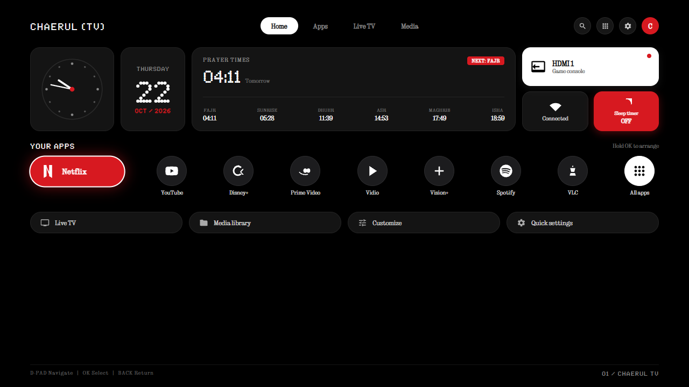
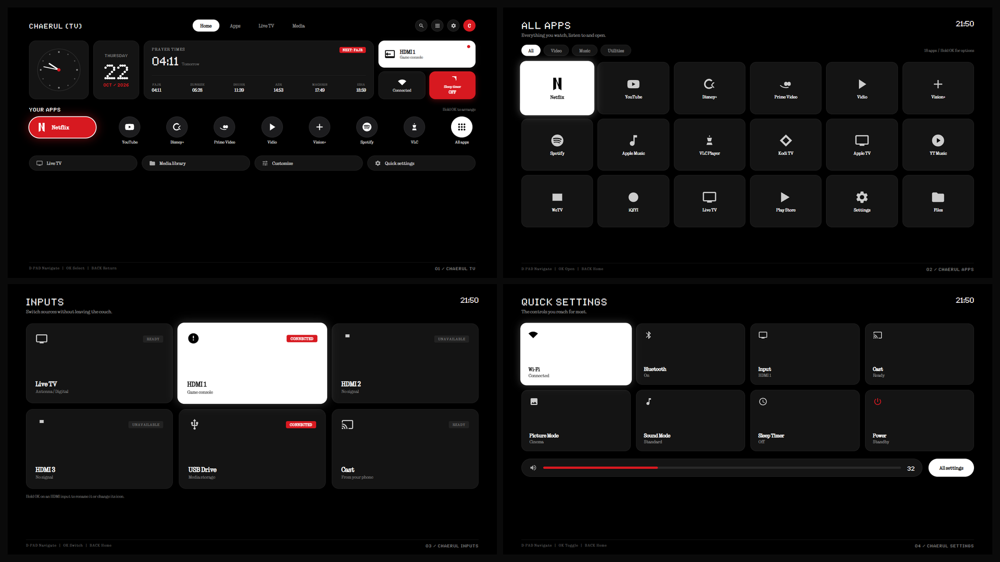

# 📺 CHAERUL (TV) — Bespoke Industrial 10-Foot UI Launcher

<p align="center">
  
</p>

<p align="center">
  
  
  
  
</p>

---

## ⚡ Overview

**CHAERUL (TV)** is a bespoke, zero-bloatware 10-foot user interface launcher designed for modern Smart TVs running Android TV or Google TV (Android 9 to 14). Inspired by the raw industrial aesthetic of **Nothing OS**, it strips away all manufacturer advertising, sponsored content rows, and bloatware, replacing them with a precision-engineered, ultra-responsive dark-mode dashboard.

### 🌟 Key Features
* **True Black OLED Background (`#000000`):** Maximizes screen contrast and saves power.
* **Authentic Dot-Matrix Typography:** Built natively with official `Ndot 57` and `NType 82` fonts.
* **Offline Astronomical Prayer Schedule:** 5-time prayer calculation + sunrise indicator with live countdown (*Next: Fajr / Maghrib*), running 100% locally without internet dependencies.
* **Elongated Glow Capsule App Dock:** Monochrome icons that smoothly transform into an expanded **Nothing Red Pill** with a white focus ring upon remote selection.
* **4 Unified Screens:**
  1. `01 / CHAERUL TV` — Home Dashboard with Analog Clock, Calendar, Prayer Times & HDMI status.
  2. `02 / CHAERUL APPS` — Full 3×6 App Drawer with Category Filters (All, Video, Music, Utilities).
  3. `03 / CHAERUL INPUTS` — Quick Source Switcher (Live TV, HDMI 1–3, USB Drive, Google Cast).
  4. `04 / CHAERUL SETTINGS` — Quick Toggles (Wi-Fi, Bluetooth, Picture/Sound Mode, Sleep Timer) & Red Volume Slider.

---

<p align="center">
  
</p>

---

## 🚀 Quick Download & Installation

### Option 1: Direct APK Download
Download the latest pre-compiled standalone APK from the **[Releases](../../releases)** tab or:
* **Direct File:** `CHAERUL_TV_v1.0.apk` (2.09 MB)

### Option 2: Over Wi-Fi ADB (One-Line Silent Install)
Make sure your laptop and TV are on the same Wi-Fi network:
```bash
# 1. Connect to your TV (replace with your TV's IP address)
adb connect 192.168.1.XX:5555

# 2. Install CHAERUL (TV)
adb install -r -d CHAERUL_TV_v1.0.apk
```

### Option 3: TV Downloader App (Zero PC Needed)
1. Open the **Downloader** app on your Android TV / Google TV.
2. Enter the direct download URL or short code:  
   👉 `https://github.com/ChaerulHidayat17/chaerul-tv/releases/download/v1.0.0/CHAERUL_TV_v1.0.apk`
3. Click Install $
ightarrow$ Press **HOME** on your remote $
ightarrow$ Select **Always**!

---

## 🛠️ Complete Deployment Documentation

For comprehensive step-by-step guidance on sideloading onto client/family TVs, unlocking developer mode, and disabling stock Xiaomi PatchWall or Google TV launcher ads, refer to:
* 📄 **[PANDUAN_INSTALASI_CHAERUL_TV.md](CHAERUL_TV_DEPLOYMENT_GUIDE.md)**

---

## 📜 License & Credits

* **Author:** Chaerul Hidayat ([@ChaerulHidayat17](https://github.com/ChaerulHidayat17))
* **Core Base:** CleanYourTV (Gathin23)
* **Design Philosophy:** Nothing Technology Ltd. (Nothing OS)
